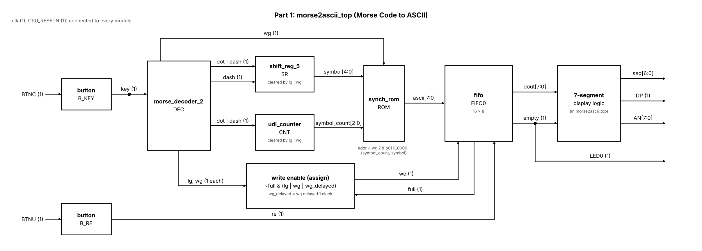
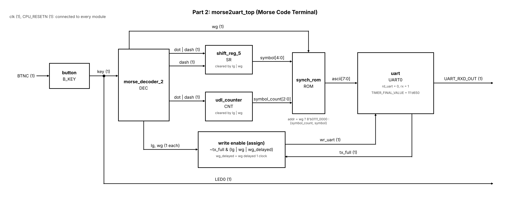

# Lab 11 – Morse Code to ASCII and Morse Code Terminal

**Course:** ECE 3300L – Digital Logic Design Laboratory
**Board:** Nexys A7-100T
**Tools:** Verilog, Xilinx Vivado

## Files

| File | Description |
|---|---|
| [`morse2ascii_top.v`](verilog/design/morse2ascii_top.v) | Part 1 board top level: buttons, LED and two-digit seven-segment display |
| [`morse2ascii.v`](verilog/design/morse2ascii.v) | Part 1 core: Morse decoder, shift register, counter, ROM and FIFO |
| [`fifo.v`](verilog/design/fifo.v) | 16 x 8 FIFO that stores decoded ASCII characters |
| [`morse2uart_top.v`](verilog/design/morse2uart_top.v) | Part 2 board top level: BTNC key, LED0 and UART output pin |
| [`morse2uart.v`](verilog/design/morse2uart.v) | Part 2 core: same decoder and ROM, with the FIFO replaced by the UART |
| [`uart.v`](verilog/design/uart.v) | UART with baud rate generator, transmitter and receiver |
| [`uart_tx.v`](verilog/design/uart_tx.v) | UART transmitter state machine (8N1) |
| [`uart_rx.v`](verilog/design/uart_rx.v) | UART receiver state machine (unused in this lab) |
| [`timer_input.v`](verilog/design/timer_input.v) | Timer with an input final value, used as the baud rate generator |
| [`fifo_generator_0.v`](verilog/design/fifo_generator_0.v) | Behavioral 16 x 8 first-word-fall-through FIFO used inside the UART |
| [`morse_decoder_2.v`](verilog/design/morse_decoder_2.v) | Decodes key presses into dot, dash, letter gap and word gap |
| [`shift_reg_5.v`](verilog/design/shift_reg_5.v) | 5-bit shift register that holds the current symbol |
| [`udl_counter.v`](verilog/design/udl_counter.v) | Up/down/load counter that counts symbols in a letter |
| [`synch_rom.v`](verilog/design/synch_rom.v) | Synchronous ROM that maps Morse symbols to ASCII |
| [`timer_parameter.v`](verilog/design/timer_parameter.v) | Timer with a parameterized final value |
| [`T_FF.v`](verilog/design/T_FF.v) | T flip-flop |
| [`moore_edge_detector.v`](verilog/design/moore_edge_detector.v) | Moore edge detector for button and key edges |
| [`button.v`](verilog/design/button.v) | Button conditioning: synchronizer, debouncer and edge detector |
| [`debouncer_delayed.v`](verilog/design/debouncer_delayed.v) | Delayed debouncer with a 20 ms timer |
| [`debouncer_delayed_fsm.v`](verilog/design/debouncer_delayed_fsm.v) | Debouncer state machine |
| [`synchronizer.v`](verilog/design/synchronizer.v) | Two-stage input synchronizer |
| [`morse2ascii_tb.v`](verilog/sim/morse2ascii_tb.v) | Part 1 testbench: keys in "SOS A" and checks the FIFO output |
| [`morse2uart_tb.v`](verilog/sim/morse2uart_tb.v) | Part 2 testbench: keys in "SOS A" and checks the bytes on the UART tx line |
| [`nexys_a7_lab11_part1.xdc`](verilog/constraints/nexys_a7_lab11_part1.xdc) | Part 1 pin constraints for the Nexys A7-100T |
| [`nexys_a7_lab11_part2.xdc`](verilog/constraints/nexys_a7_lab11_part2.xdc) | Part 2 pin constraints for the Nexys A7-100T |

## Part 1 – Morse Code to ASCII

A Morse key on BTNC is decoded into dots, dashes and gaps, converted to ASCII by a ROM, and stored in a 16-character FIFO. BTNU reads out the next character, which is shown in hex on the seven-segment display. The testbench keys in "SOS A" and checks that the FIFO returns `S O S <space> A <space>`.

**Simulation screenshot:**

**Block diagram:**

**Demo video:**

## Part 2 – Morse Code Terminal

The FIFO from Part 1 is replaced by a UART running at 9600 baud (`TIMER_FINAL_VALUE` = 650), so decoded characters are sent over USB-UART to a PC terminal. The testbench keys in "SOS A" and a receiver in the testbench samples the `tx` line to check the bytes.

**Simulation screenshot:**

**Block diagram:**

**Demo video:**

